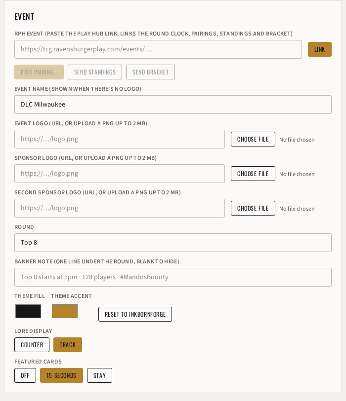
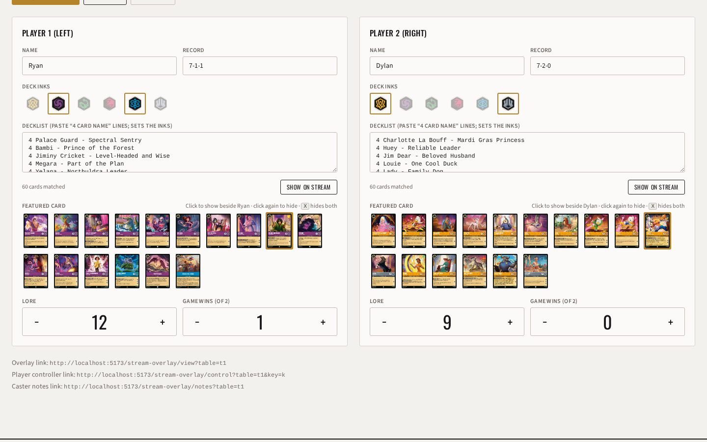
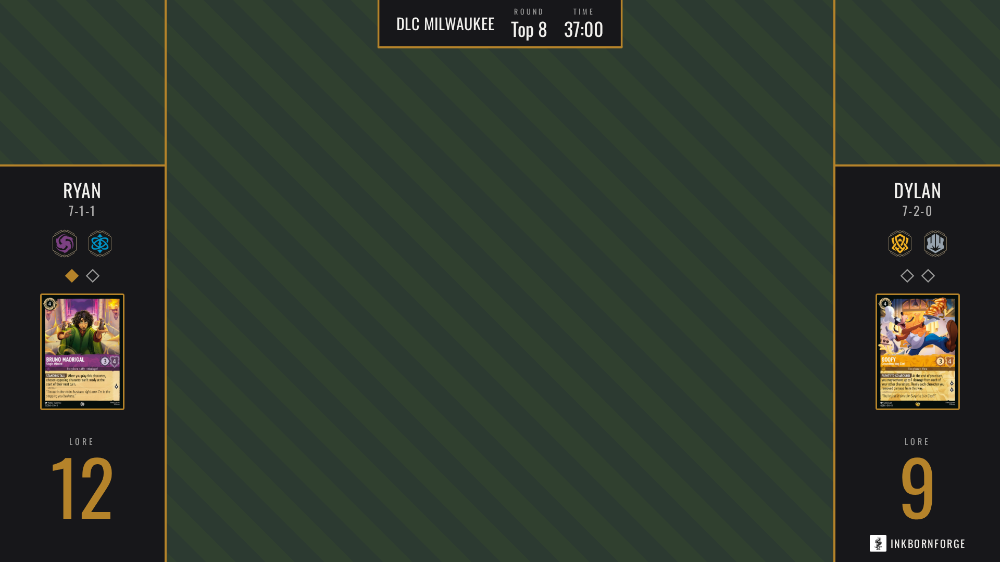
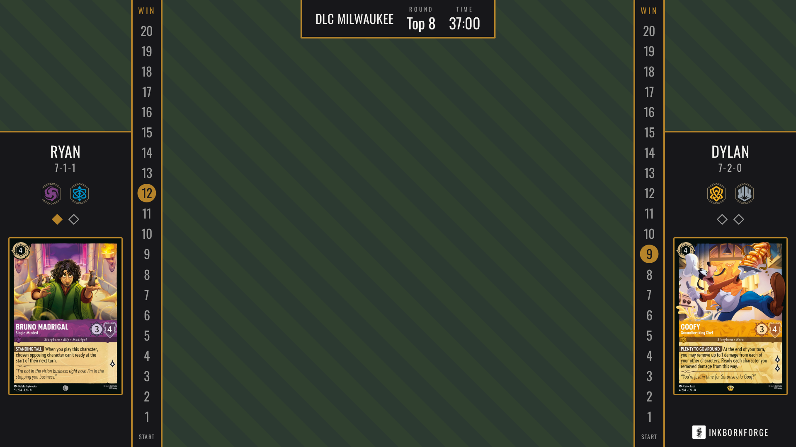

# Featured card on the Stream Overlay

**Status:** draft for review. Supporter (the panel is gated; the view stays unguarded).

## Problem

When a caster talks about a card ("he's holding up Be Prepared", "this is the Belle that wins the game"), viewers can't read it off the gameplay cam. The operator needs to put one card's full art on stream quickly, picked from the decklists already on the table, then take it off again. `docs/agents/stream-overlay.md` lists this under "deliberately not built, cheap to add".

## What exists today

- Each side's decklist is already on the row (`p1_decklist`, `p2_decklist`, migration 017), and the view already resolves it to card objects: `matchDeckList(text, cardIndex)` → `{ key, name, count, card }`, ordered by `buildBuckets()` (characters, actions/songs, items, locations, each by cost). `DeckPanel` in `StreamOverlayViewPage.jsx` does exactly this.
- LorcanaJSON's `card.images` carries `thumbnail` (367×512, what the deck panel uses) and `full` (1468×2048, same aspect, so `CARD_ASPECT` holds for both).
- `SideColumn` is a fixed-height flex column: cam cutout, name, record, inks, game-win pips, then a `mt-auto` winner slot, the lore number (`showLore`, off when `lore_track` is on) and the lockup. The space between the pips and the winner slot is empty today.
- Per-side columns are mirrored by `swapSidesPatch()` through `SIDE_FIELDS`, cleared by `clearTablePatch()` and by `featureMatchPatch()` on a new pairing.

## Mocks

Each mock is the real panel or view rendered from a mocked row, with the proposed picker and card added on top. The striped green stands in for the gameplay cam.

**Toggle** (panel, Event card, under Lore display):



**Picker** (panel, Player cards, Ryan's Bruno Madrigal featured):



**View, lore as the number** (card 162×224):



**View, lore as the track** (card 276×383):



## What the operator sees (panel)

**Featured cards: Off / 15 seconds / Stay** in the Event card, under Lore display and built the same way (a row of buttons, the current one in forge). It is per table and starts **Off**, so existing tables look exactly as they do today. Turning it on means picking **15 seconds**, the default way to use it; **Stay** is the exception for a long discussion of one card.

- **Off:** no picker on the panel, no card on the view.
- **15 seconds:** a picked card shows for 15 seconds, then fades out on its own.
- **Stay:** a picked card stays until it's taken off.

With either on, in each **Player** card, under the decklist field, a **Featured card** row: the matched deck as small thumbnails (about 56 px wide, wrapping), in `buildBuckets()` order, so a 60-card list is 15 to 25 tiles.

- Click a tile: that card goes on stream on that player's side. The tile has the forge border while the card is on stream, and loses it when the card fades out.
- Click the tile while it's on stream: it comes off now.
- Click a tile that isn't on stream (including the one that just faded): it shows again, with a fresh 15 seconds.
- Clicking another tile replaces it (one featured card per side).
- Hovering a tile shows the card's name (`title`), since 56 px art is hard to read.
- No decklist matched: the row says "Paste a decklist to feature its cards".

Hotkey **X** takes both featured cards off (letters only, as the other hotkeys). There is no hotkey per card: a Stream Deck can't name a card.

## What viewers see (view)

The card sits in its player's side column, never over the game. A `flex-1 min-h-0` slot goes right after the game-win pips, and the card's `full` image fills it with `max-w-full max-h-full` (20 px side padding, rounded corners, 3 px accent border). The lore display sets the size, so the view needs no size constants:

| Lore display | Free slot | Card |
|---|---|---|
| Number (`lore_track` off) | 280 × 244 | 162 × 224 |
| Track (`lore_track` on) | 280 × 420 | 276 × 383, width-bound |

Measured in the mocks at 1920×1080. The winner slot and the lore keep their places, so nothing below the card moves when it appears.

- It fades in once the image has loaded (`onLoad`), so a 1468×2048 JPG never paints half-loaded on stream.
- In **15 seconds** mode it fades out (500 ms) at 15 seconds from the pick. The view already re-renders every 250 ms for the clock (`now`), so the card's visibility is `now < featuredAt + 15 000` and its opacity drops over the last 500 ms. That is one rule, from the row, so an OBS source reloaded after the card has faded shows nothing.
- Taken off by a click or X, it disappears without a fade.
- It doesn't share the slot over the cam, so a deck, player card or metagame can be up at the same time. The break screen doesn't show it.
- If the decklist is edited and the card no longer matches, nothing shows. The panel doesn't write a cleanup.

## Data

Migration `027_stream_tables_featured_card.sql`:

```sql
ALTER TABLE public.stream_tables
  ADD COLUMN IF NOT EXISTS featured_cards text NOT NULL DEFAULT 'off'
    CHECK (featured_cards IN ('off', 'fade', 'stay')),
  ADD COLUMN IF NOT EXISTS p1_featured text NOT NULL DEFAULT '',
  ADD COLUMN IF NOT EXISTS p2_featured text NOT NULL DEFAULT '',
  ADD COLUMN IF NOT EXISTS p1_featured_at timestamptz,
  ADD COLUMN IF NOT EXISTS p2_featured_at timestamptz;
```

plus `stream_table_public()` extended with the five columns (the 026 function, five keys added).

A pick writes `pN_featured` (the name) and `pN_featured_at` (the panel's `new Date().toISOString()`). The view compares that to its own clock, as it already does for `timer_ends_at`, so the two machines' clocks need to agree to within a second or so, as the round timer already assumes. `FEATURED_SECONDS = 15` lives in `streamOverlay.js`; it is fixed, not a setting.

`featured_cards` is event setup, like `lore_track`: `clearTablePatch()` and `featureMatchPatch()` leave it alone.

The value is the card's name as written in that side's decklist (the entry's `name`), `''` for none. The view resolves it with the same `cardIndex.get(toSimpleName(name))` lookup `matchDeckList()` uses. No image URL is stored: one source of truth, and the row stays a list of what the operator chose.

## Code changes

| File | Change |
|---|---|
| `src/lib/streamOverlay.js` | `FEATURED_SECONDS`; `featured` and `featured_at` join `SIDE_FIELDS` (swap mirrors them); `rowToState()` adds `featuredCards` and `players[].featured` / `featuredAt`; a pure `featuredVisible(mode, featuredAt, now)` returns the card's opacity (0 when hidden), used by the view and by the panel's tile border; `clearTablePatch()` and `featureMatchPatch()` reset both sides; `HOTKEYS.x = { clearFeatured: true }` |
| `src/pages/StreamOverlayPage.jsx` | Featured cards Off / 15 seconds / Stay under Lore display; `FeaturedPicker` under `DecklistField` in each Player card while it's on; the X hotkey writes `{ p1_featured: '', p2_featured: '' }` |
| `src/pages/StreamOverlayViewPage.jsx` | `SideColumn` gets the card slot after the pips, rendered while `featuredVisible()` is above 0 and `featured` resolves to a card; it takes `cardIndex` and `now` |
| `src/index.css` | one `--animate-feature-in` keyframe (opacity 0 → 1, 250 ms) in the `@theme` block |
| `src/lib/__tests__/streamOverlay.test.js` | fixture row gets the five columns; swap mirrors, clear and new pairing reset, `rowToState` maps, X maps; `featuredVisible()` at 0 s, 14.75 s, 15 s and in Stay mode |
| `docs/agents/stream-overlay.md` | migration table row, hotkey list, remove it from "deliberately not built" |

Screenshots for the PR: the view in both lore displays with a card featured, the panel's toggle, and its picker row with one tile selected.

## The reference tool's settings, and why most aren't here

The screenshot's Room settings has per-slot Animation, Speed, Rounded corners, Card back and Auto-clear. This overlay has no settings modal: everything is a column the panel writes, and fonts and layout are fixed (see Theme in the agent doc). So:

| Setting | Here |
|---|---|
| Animation, Speed | One fixed fade-in. Add a column when an organizer asks for another. |
| Rounded corners | Always on: a printed card is rounded. |
| Card back | Not built. A flip from the back is a reveal effect; the cards here are already public in the decklists. |
| Auto-clear after N seconds | Built in: **15 seconds** is the default way to show a card, **Stay** turns it off. The seconds are fixed at 15: long enough to notice the card and read its ability while the caster talks about it. |
| Caster slot | Not in v1 (see open questions). |

## Open questions

1. **Caster slot.** The reference has a third card a caster picks from any card, not only the two decks (a card the opponent might hold, a sideboard tech). It costs one more column (`caster_featured`), a search box over `cardIndex` in the panel, and a place to put it: the side columns belong to the players, so it would go over the gameplay area. Recommend leaving it out until a caster asks; it's additive.
2. **Size with the lore number.** At 162×224 the art and name read on stream but the rules text doesn't. If that's too small, the lore number (`text-[9rem]`, about 145 px) could step down while a card shows, giving the card roughly 60 px more height. Recommend shipping as is and judging it on a real stream.

## Effort

Small: one migration, about 80 lines across the panel and the view, and tests in the existing file.
